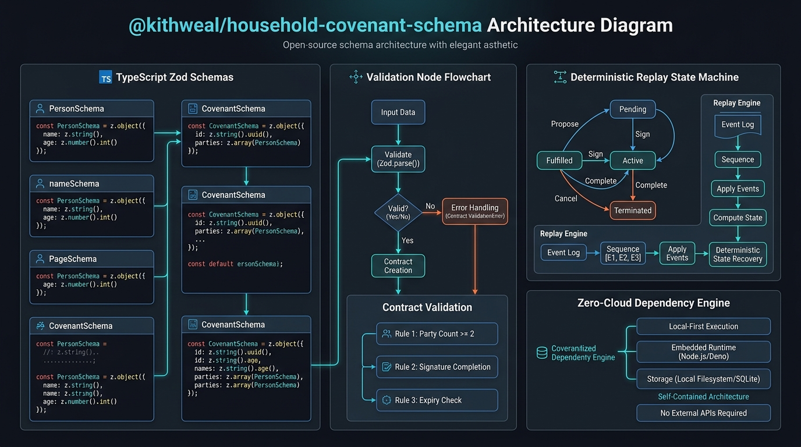

# @kithweal/household-covenant-schema

[](https://github.com/sivasubramanian86/household-covenant-schema/actions/workflows/ci.yml)
[](LICENSE)
[](package.json)
[](package.json)

**MIT-licensed runtime TypeScript schemas and deterministic replay consistency checks for voice-first household agreements, chore coordination, and mission lifecycles.**

Part of the **Build, Ship, Shape: Amazon Developer Hackathon** (Open Source Mini-Challenge companion to [KithWealAI](https://github.com/sivasubramanian86/KithWealAI)).

---

## Architecture



### Why Pure Deterministic Schemas?
Household voice systems and LLM assistants often suffer from hallucinated constraints, ambiguous chore rules, and untraceable escalation. `@kithweal/household-covenant-schema` solves this by introducing:

1. **Zero-Cloud Portability:** Pure Zod runtime contracts. Runs entirely in browser runtimes, offline edge devices, Node.js, Deno, or AWS Lambda without external API keys or cloud dependencies.
2. **Formal State Verification:** Deterministic state machine verifying allowed transitions across `DRAFT` → `READY` → `ACTIVE` → `COMPLETED` / `CANCELLED` / `BLOCKED`.
3. **Counterfactual Event Sourcing:** Immutable event replay verifier allowing households to test "what-if" rule adjustments without mutating real database state.

---

## Installation

```bash
npm install @kithweal/household-covenant-schema zod
```

---

## Quickstart

```typescript
import {
  CovenantContractSchema,
  ReplayScenarioSchema,
  verifyReplayConsistency,
} from "@kithweal/household-covenant-schema";

// 1. Validate a candidate household covenant
const candidate = {
  covenantId: "cov-kitchen-1",
  version: 1,
  familyId: "fam-north-ridge",
  title: "Kitchen Sink Leak Protocol",
  rules: [
    {
      ruleId: "rule-leak-triage",
      description: "Triage water leaks immediately upon verbal notice",
      condition: { code: "LEAK_REPORTED", params: { urgency: "high" } },
    },
  ],
  status: "ACTIVE",
};

const contract = CovenantContractSchema.parse(candidate);
console.log("Valid covenant:", contract.title);

// 2. Perform non-destructive counterfactual replay
const scenario = ReplayScenarioSchema.parse({
  missionId: "mission-leak-001",
  initialState: "READY",
  initialVersion: 1,
  events: [
    {
      missionId: "mission-leak-001",
      eventId: "evt-001",
      requestId: "req-001",
      requestFingerprint: "fp-abc",
      eventType: "STATE_TRANSITION",
      fromState: "READY",
      toState: "ACTIVE",
      fromVersion: 1,
      toVersion: 2,
      actor: "adult-1",
      timestamp: new Date().toISOString(),
      explanation: { code: "STARTED_REPAIR", metadata: {} },
    },
  ],
  alternatePath: {
    "req-001": "CANCELLED",
  },
});

const report = verifyReplayConsistency(scenario);
console.log("Replay consistent:", report.consistent);
console.log("Alternate Outcome:", report.replayedState); // "CANCELLED"
```

---

## Core Schema Contracts

### 1. `CovenantContractSchema`
Enforces structural validity on household agreements:
- `covenantId` & `familyId`: Non-empty identifiers.
- `rules`: Strict array of conditions and optional escalation ladders.
- `quietHours`: Enforces valid hour/minute ranges and timezone strings.
- `exceptions`: Rule override parameters with explicit activating roles.

### 2. State Transition Machine
Allowed mission transitions:
| From State | Allowed Target States |
|---|---|
| `DRAFT` | `READY`, `CANCELLED` |
| `READY` | `ACTIVE`, `CANCELLED`, `BLOCKED` |
| `ACTIVE` | `WAITING_FOR_CONFIRMATION`, `ESCALATION_PENDING`, `COMPLETED`, `CANCELLED`, `BLOCKED` |
| `WAITING_FOR_CONFIRMATION` | `COMPLETED`, `ACTIVE`, `ESCALATION_PENDING`, `CANCELLED` |
| `ESCALATION_PENDING` | `ESCALATED`, `COMPLETED`, `CANCELLED`, `ACTIVE` |
| `ESCALATED` | `COMPLETED`, `CANCELLED`, `BLOCKED` |
| `COMPLETED` | *Terminal* |
| `CANCELLED` | *Terminal* |
| `BLOCKED` | `READY`, `ACTIVE`, `CANCELLED` |

---

## Contributing & Security

- [CONTRIBUTING.md](CONTRIBUTING.md) — local testing and pull request workflow.
- [SECURITY.md](SECURITY.md) — vulnerability reporting and policy.
- [LICENSE](LICENSE) — MIT License.

